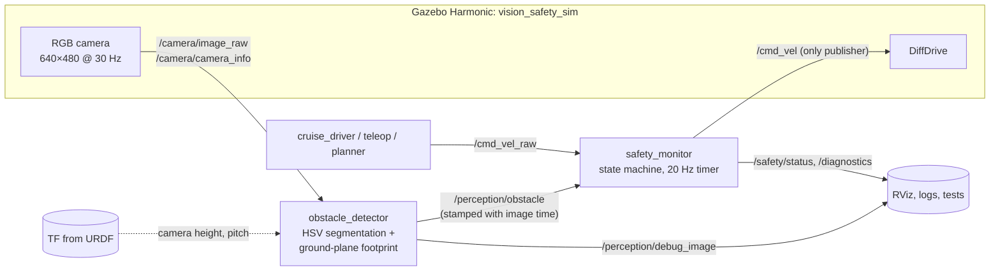
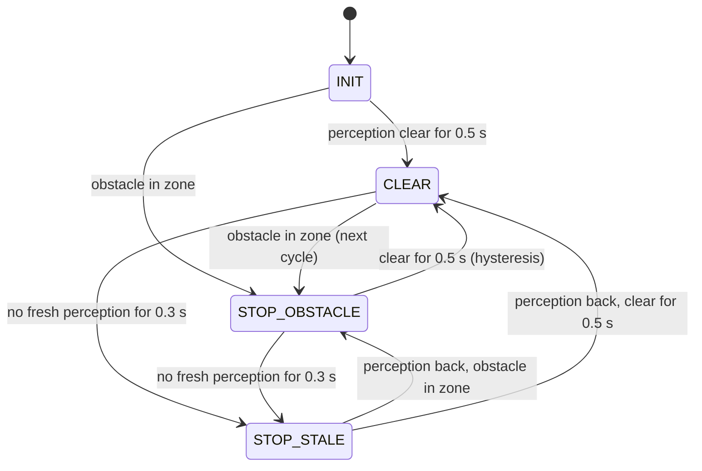

# Vision-Based Obstacle Detection & Safety Stop for ROS 2

[](https://github.com/kavinaya2808/ros2-vision-safety-system/actions/workflows/ci.yml)


A mobile robot drives down a corridor with a single RGB camera. A C++/OpenCV node finds obstacles
and estimates **how far away they are in metres, without a depth sensor**. A separate safety node,
the only node allowed to command the wheels, stops the robot before it gets too close, and keeps
it stopped when perception goes silent.


The interesting part is not detecting a red box. It is building a small safety component that
**behaves predictably when things go wrong** (a frozen camera, late messages, a controller that
keeps pushing forward, a second node publishing velocity commands) and proving that with tests.

## Results at a glance

Measured in headless Gazebo by the automated scenario test, robot cruising at 0.3 m/s,
stop gap set to 0.60 m ([full report](docs/test_results.md)):

| | Measured | Why it matters |
|---|---|---|
| Distance estimate vs ground truth at the stop decision | **0.593 m vs 0.585 m** (8 mm error) | Monocular, no depth camera |
| Travel after the stop decision | **2.2 cm** | Matches the 2 m/s² deceleration limit: 0.3² / (2·2) = 2.25 cm |
| Decision to standstill | **0.17 s** | |
| Final distance to the obstacle | **0.56 m** | Stops well short of contact |
| Creep while blocked (planner still pushing forward for 3 s) | **0.0 m** | No forward command leaks through |
| Resume delay once the path is clear | **0.55 s** | 0.5 s hold time plus one 50 ms control cycle |
| Perception time per 640×480 frame | **0.7 ms** | ~45× headroom at 30 fps |
| Tests | **124 test cases, 0 failures** | Unit, node-level and full-simulation tests |

## Architecture



All decision logic lives in **`vision_safety_core`**, a plain C++17 library with no ROS
dependency. The ROS nodes are thin wrappers that move data between topics and that library,
which is why most of the behaviour can be unit-tested in milliseconds without starting ROS
or Gazebo.

| Package | Contents |
|---|---|
| `vision_safety_core` | Colour detector, ground-plane danger zone, safety state machine, debug overlay. 95 GTests. |
| `vision_safety_interfaces` | `ObstacleDetection.msg`, `SafetyStatus.msg` |
| `vision_safety_ros` | `obstacle_detector`, `safety_monitor`, `cruise_driver` nodes (also loadable as components) + node-level launch tests |
| `vision_safety_sim` | Robot URDF (diff drive + camera), corridor world, ROS ↔ Gazebo bridge |
| `vision_safety_bringup` | `system.launch.py`, parameter files, RViz config, Gazebo scenario tests |

## Design decisions

### 1. Distance from the floor, not from apparent size

A common shortcut is "the bigger the box in the image, the closer the obstacle". That breaks
immediately: a small object close by looks smaller than a large object far away.

Instead, the detector uses the fact that an obstacle on the floor *touches* the floor. With the
camera's height and pitch (read from TF, i.e. from the URDF) and its intrinsics (from
`camera_info`), the image row where an object meets the floor maps to a distance in metres:


This is done **for every image column of the blob**, which gives the obstacle's footprint on
the floor. A footprint point counts as dangerous if it is inside the robot's path width and
closer than the stop gap.

The per-column part came from a bug. My first version projected the bounding box's bottom edge.
Before running anything in Gazebo, I rendered synthetic 3D scenes and pushed them through the
pipeline. A box *beside* the path was flagged as blocking it, because its top face projects
towards the image centre and widens the bounding box. Following the blob's real lower outline
fixed it, and that scene is now a regression test:


### 2. Silence is never "clear"

- The detector publishes **nothing** until it knows the camera intrinsics and extrinsics, and
  nothing for a frame that fails to process.
- Each detection carries the **source image's timestamp**, not the publish time, so a frozen
  camera pipeline that keeps republishing old results is still caught.
- The safety monitor stops the robot when the newest detection is older than 0.3 s (`STOP_STALE`),
  and rejects detections older than the newest one it already has, so late messages can never
  overwrite fresher information.
- It starts in `INIT` and outputs zero until perception has been seen.

### 3. A timer, not a message forwarder

Gazebo's DiffDrive, like many real motor drivers, keeps executing the **last** command it received.
If the safety node only forwarded commands as they arrived, a stop decision made between two
commands would never reach the wheels. So `/cmd_vel` is published from a fixed 20 Hz timer, and
an upstream command older than 0.5 s is replaced by zero.

### 4. Stopping is immediate, resuming is cautious



Any single sighting restarts the 0.5 s hold timer, so a flickering detection can never release
the robot. While blocked, reversing and turning away are still allowed (configurable).

### 5. One publisher on `/cmd_vel`, enforced at runtime

Every upstream controller publishes to `/cmd_vel_raw`; only `safety_monitor` publishes `/cmd_vel`.
Because a mis-remapped teleop node would silently bypass the safety layer, the node checks the ROS
graph and raises a **`/diagnostics` error** if a second `/cmd_vel` publisher appears.

### Smaller things worth knowing

- **No duplicated configuration:** camera height and pitch come from TF, intrinsics from
  `camera_info`. Moving the camera in the URDF is enough, no YAML to keep in sync.
- **Live tuning with validation:** every threshold can be changed with `ros2 param set`. Invalid
  values are rejected with a reason, using the same validation as the core library.
- **Simulation resets:** a backward jump in sim time resets the safety state instead of making it
  reject every new detection as "older than the last one".
- **Testable time:** the core state machine takes time as an argument instead of reading a clock,
  so tests like "detection at 1.05 s, check at 1.35 s" run instantly and never flake.

## Testing

| Layer | Runs | Count | Examples |
|---|---|---|---|
| Unit (GTest) | `vision_safety_core`, no ROS | 95 | decision table for every state × command × policy, HSV hue wrap-around, ground projection round-trip, synthetic 3D scenes through the whole pipeline |
| Node-level (`launch_testing`) | real nodes, fake inputs, no Gazebo | 20 | stop within one 50 ms cycle, stale stop timing, late stamps rejected, a 10 m/s request cannot leak through, rogue `/cmd_vel` publisher reported, invalid parameters rejected |
| Scenario | headless Gazebo, full stack | 4 | cruise and stop, stay stopped while the planner pushes, box moved mid-test → resume and drive past it |

Unit and node-level tests run in CI on every push. The Gazebo scenarios need a GPU and run locally.

How the original test scenarios map to the suites:

| ID | Scenario | Unit | Node | Gazebo |
|---|---|:-:|:-:|:-:|
| T1 | Path clear → robot keeps moving | ✅ | ✅ | ✅ |
| T2 | Obstacle enters danger zone → forward motion stops | ✅ | ✅ | ✅ |
| T3 | Obstacle leaves → motion resumes only after the hold time | ✅ | ✅ | ✅ |
| T4 | Small red blob / noise → ignored | ✅ | ✅ | ✅ |
| T5 | Camera / perception stops → robot stops | ✅ | ✅ | manual |
| T6 | Late detections → rejected | ✅ | ✅ | |
| T7 | Forward command while blocked → cannot bypass | ✅ | ✅ | ✅ |

## Quick start

Requirements: Linux with Docker and an X11 desktop. A GPU is strongly recommended
(NVIDIA with the [Container Toolkit](https://docs.nvidia.com/datacenter/cloud-native/container-toolkit/latest/install-guide.html),
or Intel/AMD). The host does not need ROS; everything runs in a ROS 2 Jazzy container.

```bash
# 1. Workspace + clone
mkdir -p ~/vision_safety_ws/src && cd ~/vision_safety_ws/src
git clone https://github.com/kavinaya2808/ros2-vision-safety-system.git
cd ros2-vision-safety-system/docker

# 2. Container user = your host user. For Intel/AMD use gpu-dri.yml instead of gpu-nvidia.yml.
printf "HOST_USER=%s\nHOST_UID=%s\nHOST_GID=%s\nCOMPOSE_FILE=docker-compose.yml:gpu-nvidia.yml\n" \
  "$(id -un)" "$(id -u)" "$(id -g)" > .env

# 3. Build and start the container
xhost +local:docker
docker compose build
docker compose up -d
docker exec -it vision_safety bash
```

Inside the container:

```bash
colcon build --symlink-install
source install/setup.bash
ros2 launch vision_safety_bringup system.launch.py
```

Gazebo and RViz open, the robot drives towards the red box and stops. Move the box sideways in
Gazebo (translate tool) and it continues.

### Useful variations

```bash
# Drive yourself. Teleop MUST publish to cmd_vel_raw, never cmd_vel:
ros2 launch vision_safety_bringup system.launch.py cruise:=false
ros2 run teleop_twist_keyboard teleop_twist_keyboard --ros-args -r cmd_vel:=cmd_vel_raw

# Faster cruise, no GUIs
ros2 launch vision_safety_bringup system.launch.py cruise_speed:=0.5 headless:=true rviz:=false

# Watch the decisions
ros2 topic echo /safety/status --field reason
ros2 topic echo /perception/obstacle --field gap_m

# Tune live
ros2 param set /obstacle_detector zone.stop_gap_m 0.9
ros2 param set /safety_monitor clear_hold_time_s 1.0

# Simulate a perception crash (T5): the robot stops within ~0.3 s
pkill -f lib/vision_safety_ros/obstacle_detector

# Move the box out of the path (T3)
gz service -s /world/corridor/set_pose --reqtype gz.msgs.Pose --reptype gz.msgs.Boolean \
  --timeout 2000 --req 'name: "red_obstacle", position: {x: 3.0, y: 0.8, z: 0.15}'
```

### Run the tests

```bash
colcon test --packages-select vision_safety_core vision_safety_ros   # unit + node, ~1 min
colcon test --packages-select vision_safety_bringup                  # Gazebo scenarios, ~1-2 min
colcon test-result --verbose
cat /tmp/vision_safety_results/sim_metrics.md                        # measured stop metrics
```

If the headless camera does not render on your machine, run the scenarios with the Gazebo GUI:
`VISION_SAFETY_SIM_HEADLESS=0 colcon test --packages-select vision_safety_bringup`.

## Limitations

Being explicit about what this is *not*:

- **Not a safety-rated system.** It is a software monitoring layer in simulation. Real mobile
  robots meet functional-safety standards (e.g. ISO 13849, ISO 3691-4) with certified safety
  laser scanners and safety controllers, not a camera and a ROS node.
- **Colour-specific by design.** Only red obstacles are detected; the blue box in the corridor is
  invisible to it on purpose. The detector is deliberately simple so the project can focus on the
  safety architecture and testing around it.
- **Flat-floor assumption.** Distance comes from where an object meets the floor. Overhanging
  objects (a table top) appear farther away than they are; a large-blob safety net partly covers
  this. Camera roll and yaw are assumed near zero, and the node warns at startup if TF says otherwise.
- **Last-command behaviour.** If `safety_monitor` itself crashed, the simulated drive would keep
  its last command. Real motor controllers need their own command watchdog.
- **Simulation only.** Thresholds were tuned in Gazebo's lighting; a real camera needs re-tuning.

## What I would do next

- Fuse a depth camera (Gazebo `rgbd_camera`) and compare against the monocular estimate.
- Make the stop gap speed-dependent (v² / 2a + v·latency) instead of fixed.
- Swap the colour detector for a learned detector behind the same `ObstacleDetection` contract.
- Run the same stack on a second robot (e.g. TurtleBot 4) by remapping topics only.

## Repository layout

```
ros2-vision-safety-system/
├── vision_safety_core/          C++ library + GTests (no ROS)
├── vision_safety_interfaces/    messages
├── vision_safety_ros/           nodes + node-level launch tests
├── vision_safety_sim/           URDF, world, bridge config, sim launch
├── vision_safety_bringup/       system launch, params, RViz, Gazebo scenario tests
├── docker/                      Dockerfile, compose files, .env.example
├── docs/                        test results, figures
└── .github/workflows/ci.yml     build + test on every push
```

## License

MIT, see [LICENSE](LICENSE).
