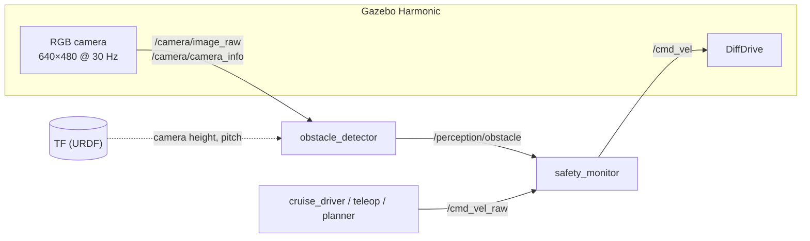
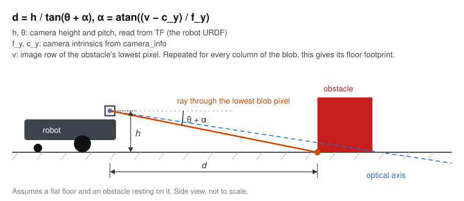
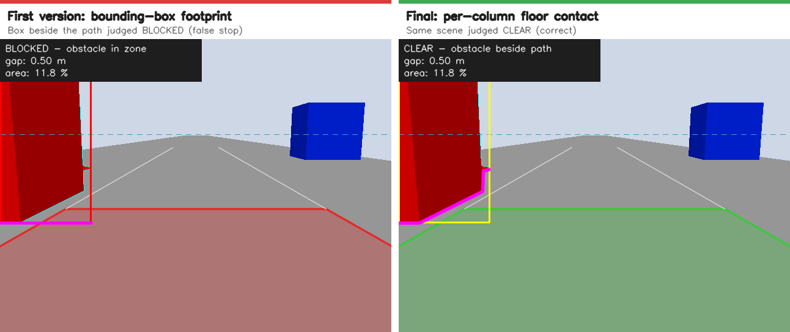
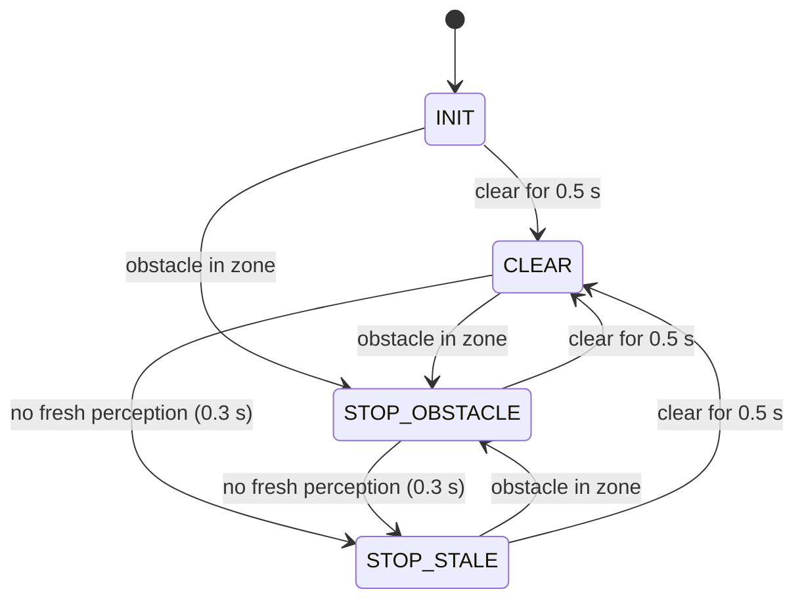

# ros2-vision-safety-system

[](https://github.com/kavinaya2808/ros2-vision-safety-system/actions/workflows/ci.yml)


Camera-based obstacle detection and a safety stop layer for a differential-drive robot in ROS 2.
A C++/OpenCV node detects obstacles in the RGB stream and estimates their distance from a single
camera using a ground-plane model. A separate safety node gates all velocity commands and stops
the robot before an obstacle, on stale perception, or when the simulation clock stalls.


## Results

Single scenario, 0.3 m/s, stop gap 0.60 m ([details](docs/test_results.md)):

| Metric | Value |
|---|---|
| Distance estimate at the stop decision | 0.593 m (ground truth 0.585 m) |
| Travel after the stop decision | 2.2 cm |
| Decision to standstill | 0.17 s |
| Perception time per 640×480 frame | 0.7 ms |

Randomized study: 30 scenarios with box size 0.10–0.40 m, start distance 1.5–3.5 m and random
lateral offset, each in a fresh headless Gazebo instance:

| Case | Expected | Runs | Correct |
|---|---|---|---|
| Box overlaps the robot | stop | 13 | 13 |
| Box clearly beside the path | pass | 7 | 7 |
| Box near the path edge | either | 8 | 5 stopped, 3 passed |

| Speed | Final distance to obstacle |
|---|---|
| 0.2 m/s | 0.58–0.59 m |
| 0.3 m/s | 0.56 m |
| 0.5 m/s | 0.50–0.52 m |

Edge-case decisions split at the configured path half-width (0.24 m): stopped for inner edges
≤ 0.225 m, passed for ≥ 0.27 m. Two of the 30 runs were excluded because the simulator failed
to start.

## Architecture



| Package | Description |
|---|---|
| `vision_safety_core` | ROS-independent C++ library: colour detector, ground-plane danger zone, safety state machine, clock watchdog, debug overlay |
| `vision_safety_interfaces` | `ObstacleDetection`, `SafetyStatus` messages |
| `vision_safety_ros` | `obstacle_detector`, `safety_monitor`, `cruise_driver` nodes (also available as components) |
| `vision_safety_sim` | Robot URDF, corridor world, ROS–Gazebo bridge |
| `vision_safety_bringup` | Launch files, parameters, RViz config, scenario tests, robustness study |

### Perception

- HSV segmentation (two hue bands for red), morphological filtering, largest connected component.
- Distance from the ground plane: the lowest blob pixel in each image column is projected onto the
  floor using the intrinsics from `camera_info` and the camera height and pitch from TF. The result
  is the obstacle's footprint in metres, tested against the robot's path width and the stop gap.
- Each `ObstacleDetection` carries the source image timestamp.



Projecting per column rather than the bounding box keeps boxes beside the path out of the path
(the top face of a box widens its bounding box towards the image centre):



### Safety monitor



- Only node publishing `/cmd_vel`; upstream controllers publish `/cmd_vel_raw`. A second `/cmd_vel`
  publisher is reported as an error on `/diagnostics`.
- Publishes from a 20 Hz wall-clock timer. The simulated drive repeats its last command, so the
  output is re-asserted every cycle and does not depend on `/clock`.
- Freshness is judged from the image timestamp; out-of-order detections are rejected.
- A clock watchdog forces zero output when ROS time is not advancing.
- While blocked, reversing and turning are allowed (`block_forward_only`).
- Upstream commands older than 0.5 s are replaced by zero.
- Status on `/safety/status` and `/diagnostics`.

## Getting started

Requires Linux with Docker and X11. An NVIDIA (Container Toolkit) or Intel/AMD GPU is recommended.

```bash
mkdir -p ~/vision_safety_ws/src && cd ~/vision_safety_ws/src
git clone https://github.com/kavinaya2808/ros2-vision-safety-system.git
cd ros2-vision-safety-system/docker

# Container user = host user. Use gpu-dri.yml for Intel/AMD.
printf "HOST_USER=%s\nHOST_UID=%s\nHOST_GID=%s\nCOMPOSE_FILE=docker-compose.yml:gpu-nvidia.yml\n" \
  "$(id -un)" "$(id -u)" "$(id -g)" > .env

xhost +local:docker
docker compose build && docker compose up -d
docker exec -it vision_safety bash
```

In the container:

```bash
colcon build --symlink-install
source install/setup.bash
ros2 launch vision_safety_bringup system.launch.py
```

## Usage

```bash
# Launch options
ros2 launch vision_safety_bringup system.launch.py cruise:=false        # no automatic driving
ros2 launch vision_safety_bringup system.launch.py cruise_speed:=0.5
ros2 launch vision_safety_bringup system.launch.py headless:=true rviz:=false
ros2 launch vision_safety_bringup safety_demo.launch.py                 # debug image window instead of RViz

# Manual driving (must publish to cmd_vel_raw)
ros2 run teleop_twist_keyboard teleop_twist_keyboard --ros-args -r cmd_vel:=cmd_vel_raw

# Monitoring
ros2 topic echo /safety/status --field reason
ros2 topic echo /perception/obstacle --field gap_m

# Parameters can be changed at runtime and are validated
ros2 param set /obstacle_detector zone.stop_gap_m 0.8
ros2 param set /safety_monitor clear_hold_time_s 1.0
```

Parameters: [`obstacle_detector.yaml`](vision_safety_bringup/config/obstacle_detector.yaml),
[`safety_monitor.yaml`](vision_safety_bringup/config/safety_monitor.yaml).

## Testing

| Suite | Scope | Tests |
|---|---|---|
| `vision_safety_core` | GTest, no ROS: state machine, detector, ground projection, synthetic 3D scenes, clock watchdog | 102 |
| `vision_safety_ros` | `launch_testing` against the real nodes with simulated inputs | 21 |
| `vision_safety_bringup` | Full stack in headless Gazebo: stop, hold, release, pass beside the obstacle | 4 |

```bash
colcon test --packages-select vision_safety_core vision_safety_ros   # unit + node tests
colcon test --packages-select vision_safety_bringup                  # Gazebo scenarios (GPU)
colcon test-result --verbose
```

CI runs the unit and node tests on every push. Randomized robustness study:

```bash
ros2 run vision_safety_bringup robustness_study.py            # 30 runs, results in /tmp/vision_safety_robustness
ros2 run vision_safety_bringup robustness_study.py --runs 5
```

## License

MIT, see [LICENSE](LICENSE).
